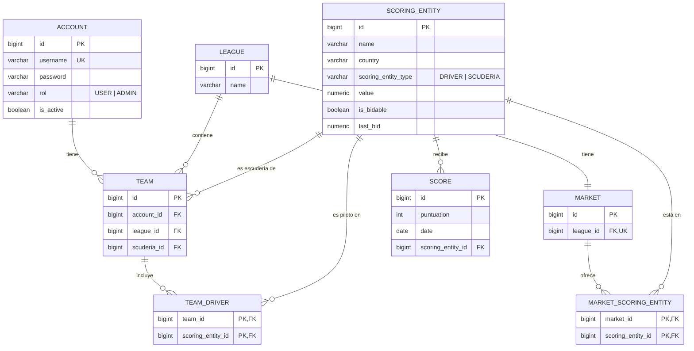

# F1 HUB

Re-adaption of F1 HUB, now integrated with multiple microservices

## DATA BASE DEFINITION

erDiagram
ACCOUNT {
bigint id PK
varchar username UK
varchar password
varchar rol "USER | ADMIN"
boolean is_active
}
